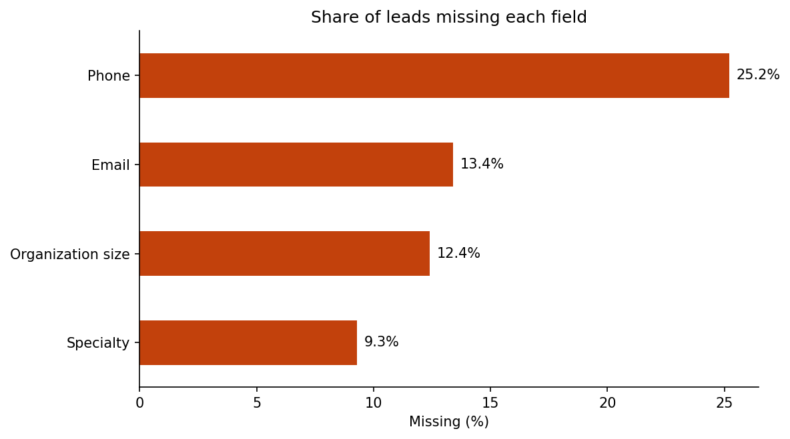
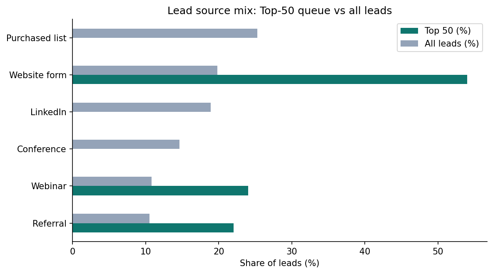

# Lead Intelligence and Scoring (SQL + Python)

A SQL pipeline that cleans a messy lead list, scores every lead from 0 to 100, and produces a ranked outreach queue for each sales owner.

> **All data in this repository is synthetic.** It is randomly generated by [`src/generate_synthetic_leads.py`](src/generate_synthetic_leads.py) to mimic a CRM export. No real organizations, people, or company data are used.

**Author:** Oluwatoyin Olawale Akadiri · [oluwatoyinakadiri.com](https://oluwatoyinakadiri.com)

## Business question
A team has 2,500 leads and limited time. Which leads should each owner contact first, and how clean is the lead list?

## Pipeline
| Step | File | What it does |
|---|---|---|
| 1 | [`sql/01_data_quality.sql`](sql/01_data_quality.sql) | Completeness of key fields and duplicate count |
| 2 | [`sql/02_clean_leads.sql`](sql/02_clean_leads.sql) | De-duplicates with `ROW_NUMBER()`, standardizes text, fills unknowns |
| 3 | [`sql/03_score_and_rank.sql`](sql/03_score_and_rank.sql) | Transparent 0-100 score (CTE), overall and per-owner `RANK()` |
| 4 | [`sql/04_kpis.sql`](sql/04_kpis.sql) | KPI scorecard by lead source |
| Run | [`src/lead_scoring.py`](src/lead_scoring.py) | Runs the SQL in SQLite and writes the outputs |

### Scoring model
| Component | Points | Signals |
|---|---|---|
| Contact completeness | 0-30 | email, phone, decision maker identified |
| Engagement | 0-35 | website visits, email opens (capped), recency |
| Outreach readiness | 0-35 | research complete, warm source, organization type |

Scores map to actions: **70+** contact this week, **50-69** nurture, **30-49** complete research, **under 30** deprioritize.

## Results (synthetic data)
- **Data quality:** 2,540 rows → 2,500 unique leads (40 duplicates removed); 25.2% missing phone, 13.4% missing email, 9.3% missing specialty.
- **Priority bands:** 261 leads to contact this week, 881 to nurture, 1,080 needing research, 278 deprioritized.
- **Top-50 queue:** every lead comes from referrals, webinars, or website forms; purchased lists are 25% of the list and supply none.
- **Research backlog:** about two-thirds of each owner's leads still need research, the biggest lever for growing the queue.




## Repository structure
```
├── data/synthetic_leads.csv               # generated, synthetic
├── notebooks/lead_scoring_prioritization.ipynb
├── sql/                                   # the four pipeline steps
├── src/generate_synthetic_leads.py
├── src/lead_scoring.py
├── tests/test_lead_scoring.py
└── images/
```

## How to run
```bash
pip install -r requirements.txt
python src/generate_synthetic_leads.py   # optional: regenerate the data
python src/lead_scoring.py               # writes outputs/ (Top 50, scored leads, KPIs)
pytest tests
```

## Limitations
The data is synthetic and the score weights are set by judgment, not learned from outcomes. With real conversion data, the next step is to check conversion rate by score band and refit the weights.

## License
MIT
